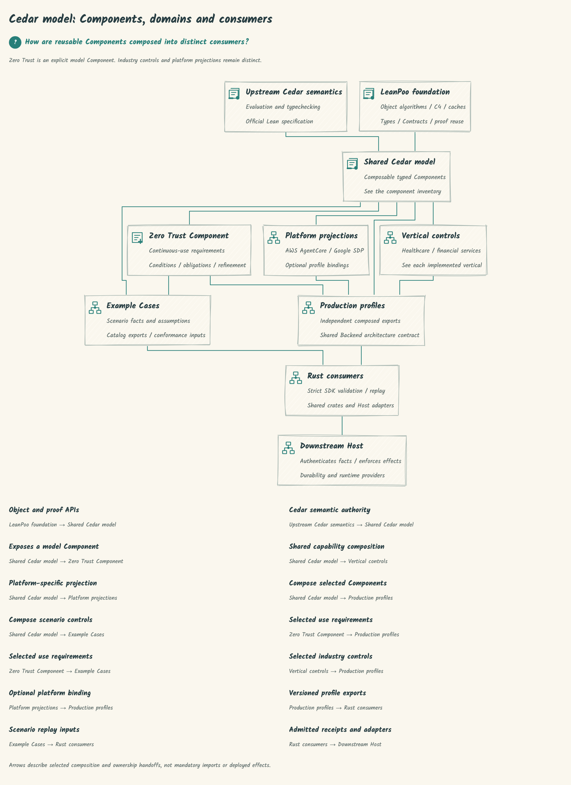
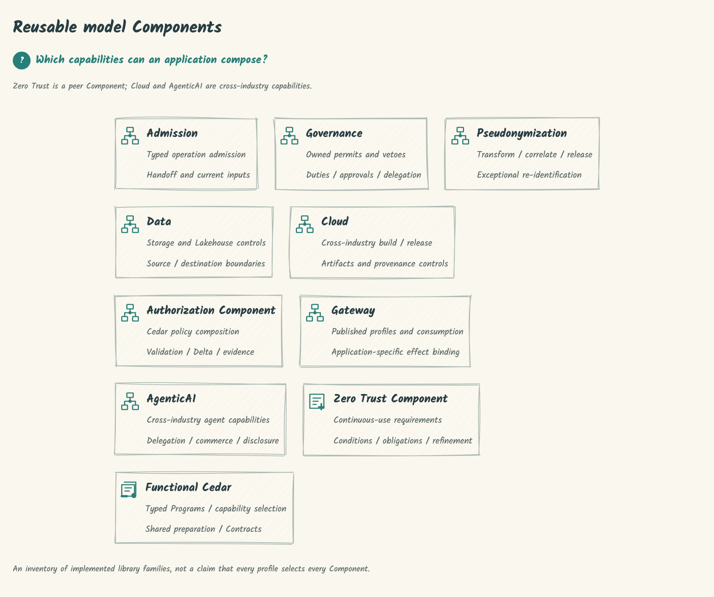
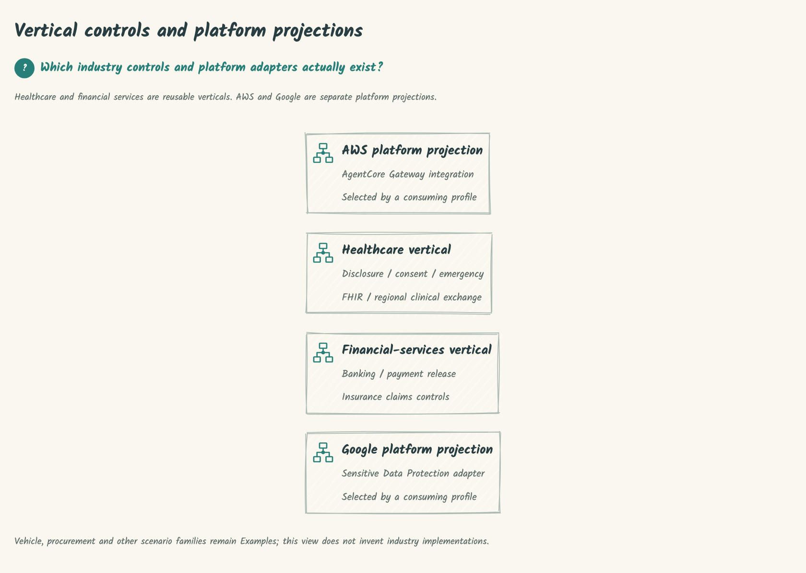

# SPDX-FileCopyrightText: 2026 hardenedlinux Linux Team and Contributors
# SPDX-License-Identifier: Apache-2.0

#+TITLE: Cedar POO Spec
#+OPTIONS: toc:2

Cedar POO Spec composes typed authorization capabilities using
[[https://github.com/tao3k/lean-poo][LeanPoo]] and the upstream
[[https://github.com/cedar-policy/cedar-spec][Cedar Lean specification]].
It binds policy construction, validation, Contracts and proofs to concrete
requests, then checks exported cases with the official Rust Cedar authorizer.

The canonical repository is [[https://github.com/hardenedlinux/cedar-poo-spec][hardenedlinux/cedar-poo-spec]].
=tao3k/cedar-poo-spec= is a mirror.

* Architecture views

Zero Trust is an important Component of the shared Cedar model. Applications
compose it with Authorization and other Components; it does not subsume
LeanPoo, Cedar semantics or the vertical libraries.

 ·  ·
 ·
[[file:dev/README.org][Model sources and rendering]]

* Architecture and ownership

| Layer | Owner | Responsibility |
|-------+-------+----------------|
| Object algorithms | LeanPoo | C4 resolution, typed object composition, dependency tracking, certified preparation and reuse. |
| Cedar semantics | Upstream cedar-spec | Expressions, evaluation, typechecking, extensions and soundness. |
| Reusable integration | =CedarPooSpec/= | Cedar-specific typed capabilities, Contracts, policy revisions, proofs and transport. |
| Production profiles | =Productions/= | Composed profiles and versioned exports, independent of Examples and Tests. |
| Scenario validation | =Examples/= and =Tests/= | Concrete cases, independent oracles, negative controls and cross-language conformance. |
| Native replay | =rust/= | SDK admission, replay receipts and domain/Host adapters. |
| Deployed effects | Downstream Host | Authenticate current facts, enforce decisions, persist effects and manage runtime authority. |

The dependency direction is from scenarios and production profiles toward the
shared library. The library and Production import closures exclude Examples
and Tests. A checked model or a successful replay does not establish deployed
Host behavior; simulation is sufficient for this repository's conformance cases.

** Shared capabilities and domain composition

[[file:CedarPooSpec/Functional/README.org][Functional Cedar]] selects typed compile,
validate, publish and authorize operations. Its prepared Programs retain checked
policy data for an immutable model/schema; each request still receives its own
authorization. [[file:docs/functional-coverage.org][Coverage]] maps all applicable
families to their types, Contracts, proofs and Rust replay.

| Library area | Scope |
|--------------+-------|
| [[file:CedarPooSpec/Authorization/README.org][Authorization]] and [[file:CedarPooSpec/ZeroTrust/README.org][ZeroTrust]] | Reusable decision and effect-boundary frameworks. |
| [[file:CedarPooSpec/Pseudonymization/README.org][Pseudonymization]], [[file:CedarPooSpec/Gateway/README.org][Gateway]], =Admission/=, =Governance/= | Cross-industry lifecycle, admission and control composition. |
| [[file:CedarPooSpec/Data/Lakehouse/README.org][Data]], [[file:CedarPooSpec/AgenticAI/README.org][AgenticAI]], [[file:CedarPooSpec/Cloud/README.org][Cloud]] | Cross-industry data, agent and build/release capabilities. |
| =CedarPooSpec/Vertical/= | Reusable healthcare and financial-services controls. |
| =CedarPooSpec/Platform/= | Platform-specific projections, including AWS. |

Industry scenarios and deployment-specific facts are composed in Examples or
downstream applications. [[file:Productions/Backend.org][Shared backend architecture]]
belongs to Production and serves multiple profiles/providers; it is independent
of any one AgenticAI example.

* Repository organization

| Path | Contents and entrypoint |
|------+-------------------------|
| =CedarPooSpec/= | Shared Lean library; [[file:docs/rfc/0008-functional-cedar-capabilities.org][Functional capability design]]. |
| [[file:Productions/README.org][Productions/]] | Production profile/export contracts and the shared backend design. |
| [[file:Examples/README.org][Examples/]] | Scenario index and adjacent modeling notes. |
| [[file:Tests/README.org][Tests/]] | Proof regressions, rejection controls and conformance fixtures. |
| [[file:rust/README.org][rust/]] | Cargo workspace, crate ownership and feature/profile selection; packages live directly under =rust/*=. |
| [[file:Benchmarks/README.org][Benchmarks/]] | Lean/Rust native workloads and separate process/resource observation. |
| =python/packages/= | Scoped Python packages for external testing and process observation. |
| =docs/= | RFCs, integration contracts, coverage and performance audits. |

* Build and verify

Use the pinned [[file:lean-toolchain][Lean toolchain]], Rust/Cargo, Just and uv.
Additional full-gate prerequisites are documented by the corresponding recipes.

#+begin_src sh
lake build
just check-quick
just check
#+end_src

=check-quick= builds the library and Lean tests. =check= runs the complete Lean,
Rust and scenario qualification. =just --list= lists focused checks;
=just lean-poo-api= inspects the locked dependency's public modules.
The [[file:lakefile.toml][Lake dependencies]] and lockfile pin exact revisions;
a deliberate dependency update is followed by =just sync= and complete checks.

The acceptance unit includes the complete 51-entry example catalog and all nine
materialized object families. Types, projection Contracts, semantic proofs and
independent Rust authorization must agree. [[file:docs/functional-coverage.org][The coverage audit]]
records the inventory and retained controls. CI separates Lean, Rust,
Cedar conformance and authorization-delta qualification.

* Native performance

#+begin_src sh
just bench-catalog-preparation
just bench-functional-catalog
#+end_src

Lean owns source construction, Program preparation, serialization workloads,
correctness checks and native timers. Rust owns SDK replay and allocation
counters. Python is limited to necessary external process/resource observation.
The [[file:Benchmarks/README.org][benchmark guide]] documents fixed workloads,
entrypoints and evidence handling. Keep all samples, including regressions;
algorithm timings, full-process wall time, CPU, allocations and RSS are separate
observations. Generated tables/logs belong in ignored build directories or CI
artifacts, not the source history.

* Design and evidence

- [[file:docs/rfc/0001-certified-authorization.org][Certified authorization]] and [[file:docs/rfc/0002-policy-module-composition.org][policy composition]] define the core integration.
- [[file:docs/rfc/0003-cedar-language-export.org][Language export]], [[file:docs/rfc/0005-cedar-replay-receipts.org][replay receipts]] and [[file:docs/rfc/0006-schema-bound-cedar-replay.org][schema-bound replay]] define cross-language boundaries.
- [[file:docs/lean-poo-alignment.org][LeanPoo alignment]] and [[file:docs/functional-coverage.org][whole-repository coverage]] connect APIs to cases and proofs.
- [[file:docs/native-performance-plan.org][Native lifecycle plan]] and [[file:docs/native-dataflow-acceptance.org][all-domain algorithm acceptance]] separate measured results, non-wins and remaining work.

* Credits and license

Cedar and =cedar-spec= are developed by the
[[https://github.com/cedar-policy][Cedar project]]. Lean-POO draws on the POOF work of
François-René Rideau, Alex Knauth, and Nada Amin. Their projects retain
their own copyright and licenses. This repository is licensed under the
Apache License 2.0; see [[file:LICENSE][LICENSE]].
