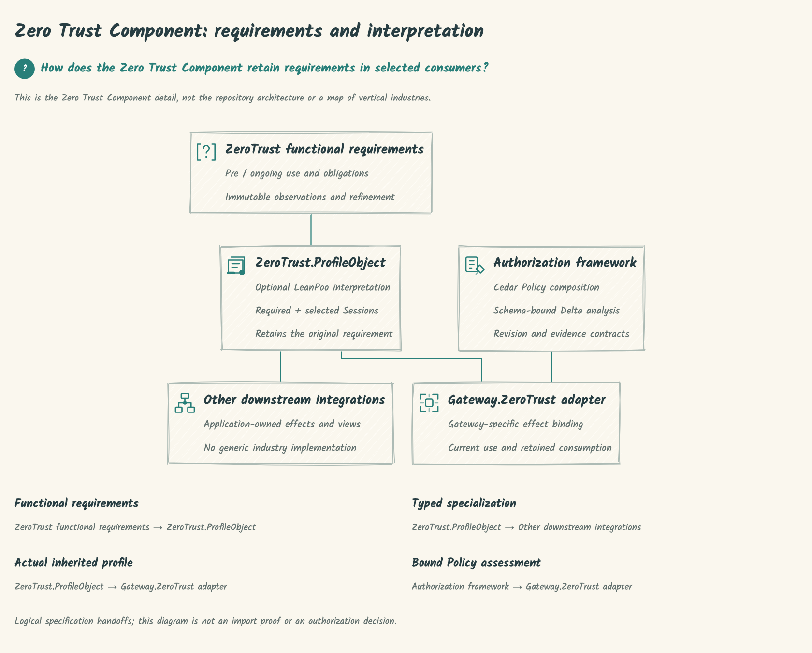
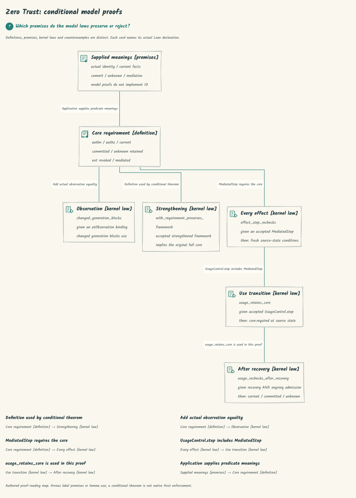
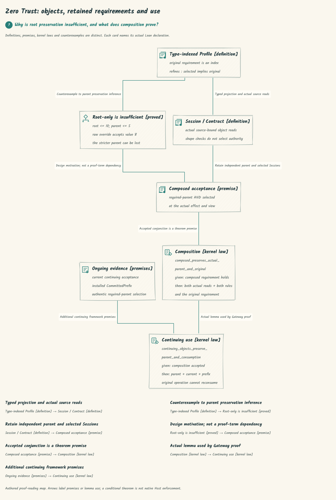
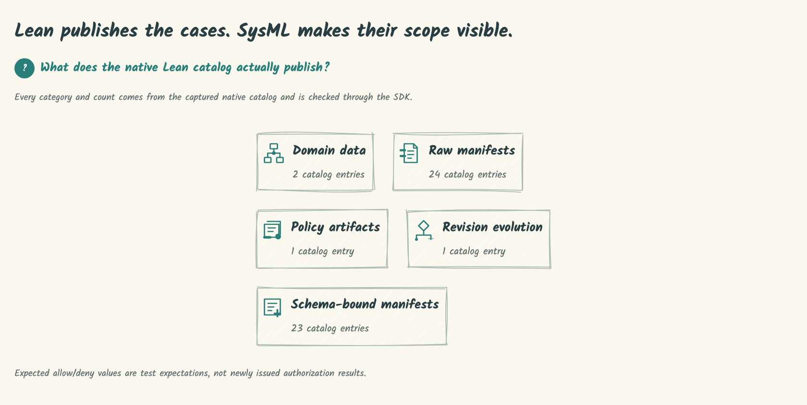

# SPDX-FileCopyrightText: 2026 hardenedlinux Linux Team and Contributors
# SPDX-License-Identifier: Apache-2.0

#+title: Lean JSON, SysML and hand-drawn engineering views
#+language: en

* One development path

Native Lean =caseManifestsNative catalog= publishes the existing SourceCatalog JSON.
=dev/catalog.ts= observes only entry headers, source-reference closure and counts;
it never parses Cedar policies or turns an expected allow/deny into a decision.
Opaque policy, schema and entity values remain =unknown= because their semantics
belong to the existing Lean/Rust owners, not to this display adapter.

=dev/sysml/lean-catalog.sysml= is generated from that exact JSON. Each original
entry retains its key, category, expectations and revision count as model data.
The overview displays category totals instead of squeezing all entries into one
unreadable diagram. The native catalog format number is read from its existing
producer contract; it is not a new Library version or namespace.

OpenSysML =connectWasm()= owns the published SDK's worker. =parseSources= receives
named source bytes, so actual SDK spans point to the SysML files. Parse errors
refuse; =renderView= supplies actual node identities, connections and model hash.
Category counts are evaluated through that same SDK model and compared with the
native JSON observation. No fabricated SDK snapshot or replacement service is used.

D2 owns Questions, display captions, icons and layout preferences. =bindView=
requires every authored subject to bind a unique SDK name and every authored edge
to match an actual SDK connection. Missing, additional or drifting relationships
refuse. Captions do not replace topology. These are logical specification handoffs,
not physical networking links or a proof that Lean import boundaries conform.

The installed deterministic-engineering renderer owns typed composition, font
measurement, ELK layout, Rough.js strokes and PNG/SVG/HTML exports. Long connection
labels become a readable source-bound legend; actual text must remain at least
12 CSS pixels. This local condition does not assert aesthetic acceptance.

* Distinct model scopes

The project architecture is compositional. Zero Trust is an important model
Component, alongside Authorization and other reusable capabilities. The optional
=ZeroTrust.ProfileObject= interpreter is not the LeanPoo foundation.

| View | Scope |
|------+-------|
| [[file:d2/architecture-overview.png][Architecture overview]] | Foundations, shared model, selected Components, consumers and Host responsibilities. |
| [[file:d2/model-components.png][Model Components]] | Reusable library families; no requirement that every profile selects every Component. |
| [[file:d2/verticals-platforms.png][Verticals and platforms]] | Actual healthcare/financial-services controls and separate AWS/Google projections. |
|  | The Component's module relationships. |
|  | Conditional refinement, observation, mediated-use and recovery laws, with premises visible. |
|  | Root-only counterexample, retained parent/selected Sessions, composition and continuing use. |
|  | Native manifest forms/counts, not an industry classification. |

=architecture.sysml= authors ownership/composition relationships and binds them
to the referenced Lean/module documentation. The SDK verifies that the generated
view matches that model; this alone cannot prove the model is architecturally
correct. Regression checks require Zero Trust's Component role and a distinct
source-bound subject for every current Vertical and Platform directory.
The existing Lean import audit independently enforces Library/Production isolation.
Vehicle, procurement and other example families are not silently promoted into
implemented generic vertical libraries. Their domain facts remain with the cases.

* Native commands
Run from the repository root:
#+begin_src sh
cd dev
bun install --frozen-lockfile
just build
just render
just test
#+end_src

=just build= uses the existing Lake target. =just prepare= directly executes the
existing compiled Lean producer; it does not start a benchmark or another test
runner. =just render= builds that existing target first and consumes those original bytes. Call =bun run render path=
with a different in-repository capture to inspect an explicitly supplied input.
The renderer rechecks source fingerprints before publishing and rejects an input
that changes while it runs. Benchmark and Rust acceptance are separate activities;
this view neither replaces them nor modifies their resource limits.

* Views and source ownership
| Input or output | Owner / purpose |
|-----------------+-----------------|
| =.generated/lean-catalog.json= | Original native Lean output; ignored build input |
| =sysml/security-frameworks.sysml= | Authored reusable-framework architecture |
| =sysml/lean-catalog.sysml= | Generated model data derived from the native catalog |
| =d2/*.d2= | Canonical Questions and presentation, without RAW TALA coordinates |
| =.generated/*-sdk.json= | Actual SDK capture, retained by model hash |
| =d2/*.png= | Hand-drawn documentation images; no external font load needed |
| =d2/*.svg= | Vector export with embedded font notices |
| =d2/*.html= | Offline materialized rendering |
| =d2/*.json= | Input/output hashes, SDK spans/model hash, input counts and observations |

The source =CedarPooSpec/ZeroTrust/architecture.d2= and its RAW SVG are migrated to
this development path. The module README displays the new PNG and links its model
and D2. Existing topology and the four original relation captions remain checked.
Git history retains the old source; there is no active RAW renderer fallback.

* Views

See the scoped views above. PNG, SVG, SysML and D2 sources live together under
=dev/=; the root README embeds only the project architecture overview.

* Licensing
Cedar remains Apache-2.0, with its existing Cedar and Faré / POOF credits unchanged.
New development glue uses that license and HardenedLinux project attribution.
The unmodified renderer archive remains LGPL-2.1-or-later; its complete source and
license are included. OpenSysML packages retain their own Apache-2.0 license.
Kalam's actual 2014 Indian Type Foundry notice and OFL-1.1 are retained in exports.
JSON, PNG and package archives use standard REUSE sidecars; comment-capable sources
carry in-file SPDX headers. =../LICENSES= contains the canonical licenses this development subtree uses.

* Audit and invalidation boundary

The host discovers top-level =d2/*.d2= declarations; it contains no figure-name
switch. Questions, themes, icons, layout options and model/name bindings stay in
D2. The existing Render Library owns D2 compilation, SDK display projection,
ELK, font measurement, Rough.js and output serialization. The local composer
adds only Cedar's heading/legend composition; it implements no layout solver.

The finite catalog categories and format 2 describe the existing Lean wire
contract, not a second policy parser or version registry. Source pools remain
opaque. Malformed declared manifests/artifacts refuse instead of silently
becoming domain data. Count expressions must pair with a catalog category.

=sources.ts= is the host filesystem boundary: it restricts input references to
the repository and compares captured content hashes before publication. It does
not replace the Library's figure fingerprints. Changed or missing SysML, D2,
JSON, adapter, renderer archive or actual Lean producer invalidates publication.
Returning to identical bytes restores content identity; no mtime lease is invented.
The receipt binds the actual producer executable and renderer archive separately
from text inputs. Source records are observations, not a signed compiler
attestation that a particular binary was derived from all transitive sources.

A changed source invalidates an old receipt; it does not erase historical images.
Run =just render= then =just test= to re-observe and validate current artifacts.
Multi-file export is not an atomic delivery protocol. Source checks cannot prevent
a later write after publication; consumers must recheck receipts before reuse.

* Platform verification

=.github/workflows/views.yml= builds the existing Lean producer, captures the
native JSON, parses/evaluates actual SysML, exports figures and runs positive /
negative controls on Linux and macOS. Platform outputs and SDK captures are
uploaded for inspection. Each platform regenerates its own producer/output
hashes; binary and image bytes are not required to match across platforms.
This CI qualifies the development rendering chain. The existing Cedar proof,
Rust, conformance and benchmark jobs retain their own acceptance boundaries.

* Proof-reading maps

The Zero Trust proof views retain actual fully qualified Lean declaration names
and source paths as SysML attributes. The SDK round-trips these attributes; the
existing test entrypoint builds the source proof modules, then Lean checks that
law/counterexample cards resolve to theorem constants and declared source paths
match their actual defining Lean modules. Premise/definition cards
are distinguished explicitly. The rendering does not create a certificate or
infer deployed Host behavior. Edges are authored logical premises/lemma uses;
the counterexample edge is explicitly design motivation. Full proof terms and
additional laws remain in the linked Lean sources and adjacent module guide.
